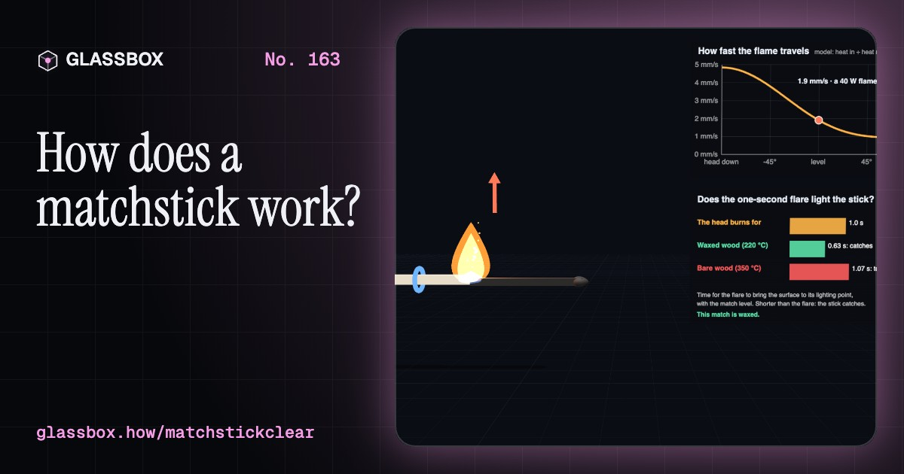
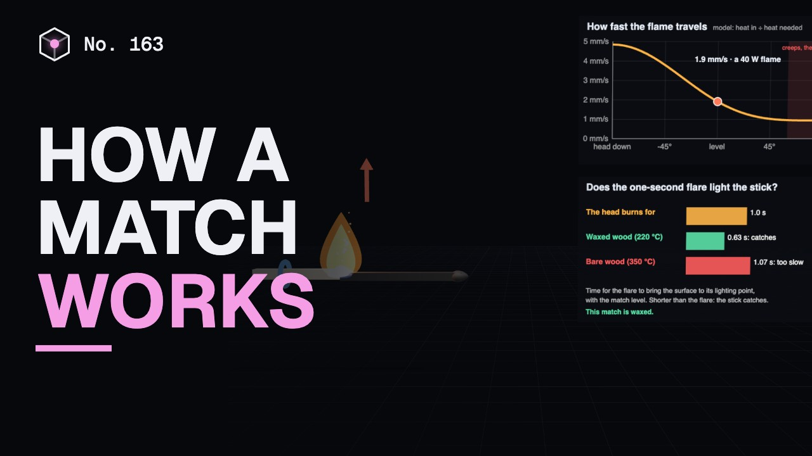
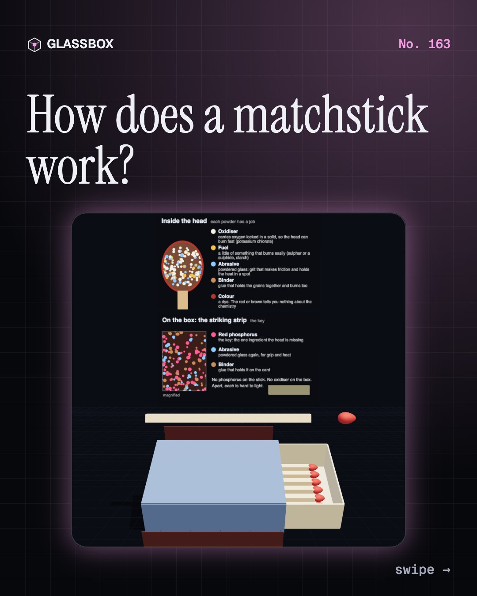
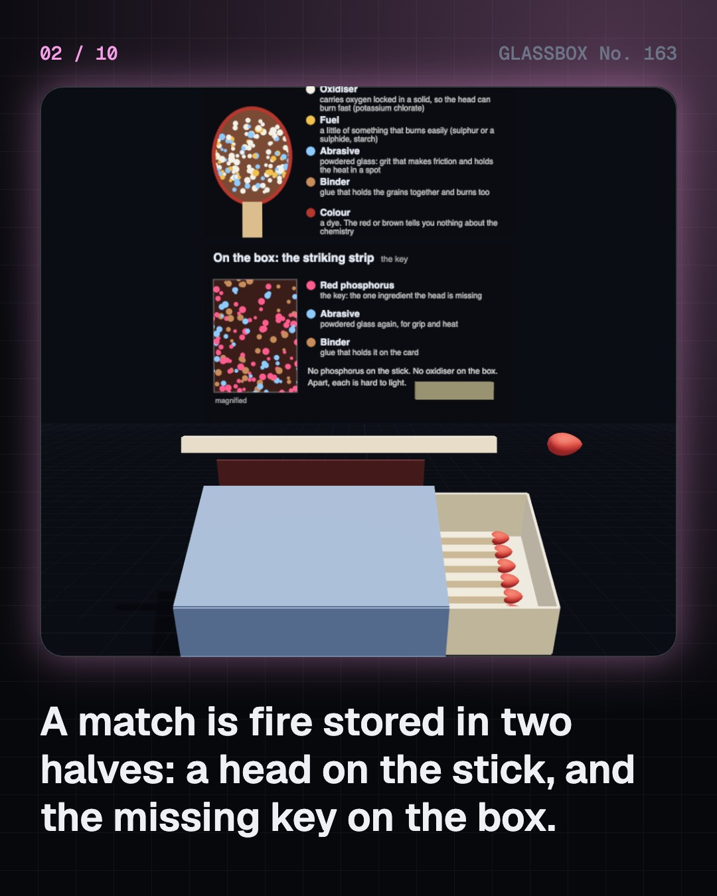
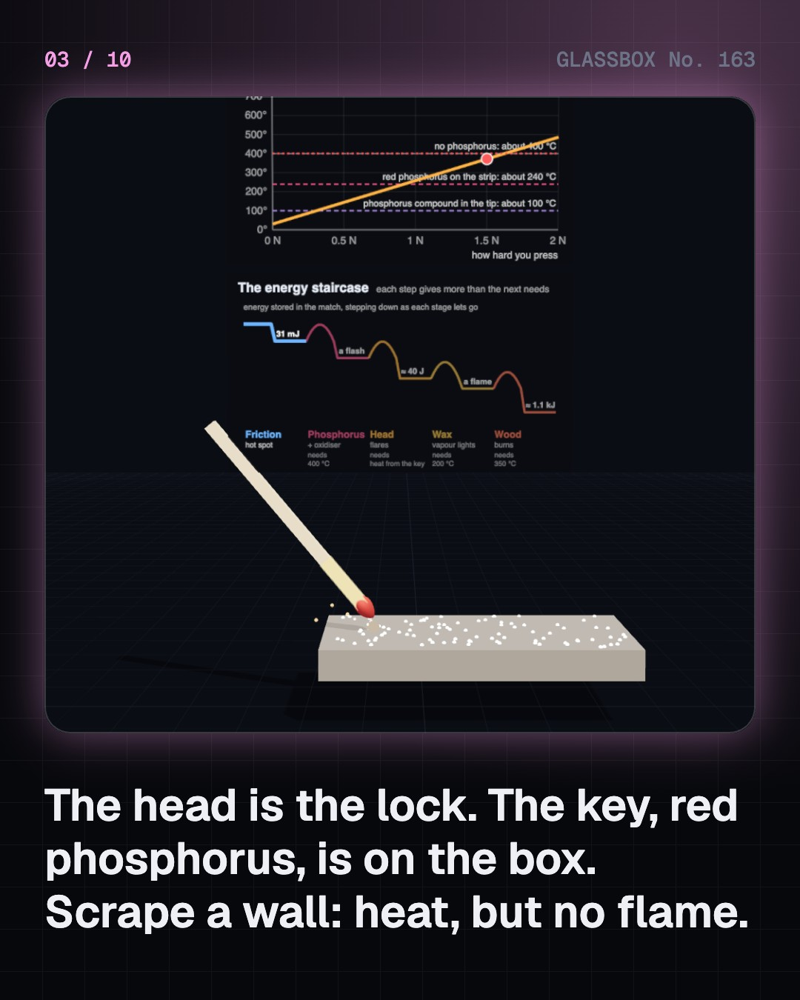
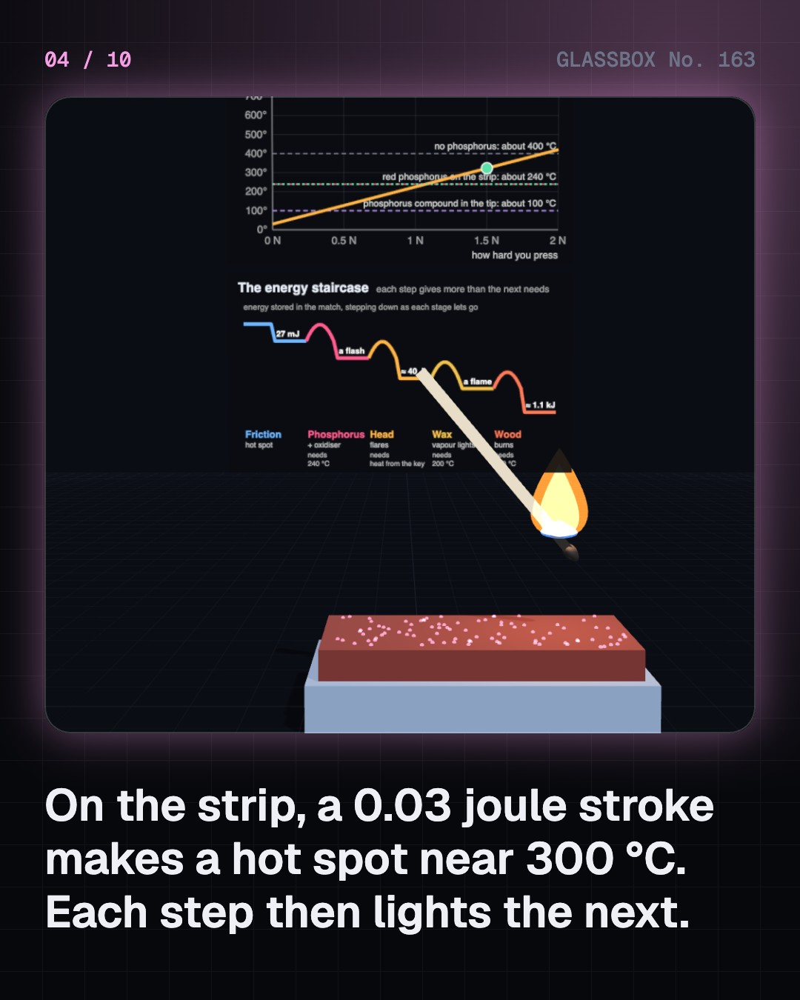

<!-- glassbox:start -->
<!-- Generated from glassbox.json by the Glassbox hub (npm run readme -- matchstickclear). Edit glassbox.json, not this block. -->
<p align="center"><a href="https://glassbox.how/e/matchstickclear/"></a></p>

<h1 align="center">MatchstickClear</h1>

<p align="center"><b>How does a matchstick work?</b><br>A match is fire stored in two halves: a head that is hard to light, and the missing key on the side of the box. Strike one in slow motion, follow five steps from a 0.03 joule rub to a burning stick, tilt the flame, and meet the workers who paid for cheap matches.</p>

<p align="center"><a href="https://glassbox.how/matchstickclear/"><b>▶ Play with it</b></a> &nbsp;·&nbsp; <a href="https://glassbox.how/e/matchstickclear/">Read the 60-second explainer</a> &nbsp;·&nbsp; <a href="https://glassbox.how/matchstickclear/glassbox/reel.mp4">Watch the 40-second video</a></p>

<p align="center">
  <a href="https://glassbox.how/e/matchstickclear/"></a>
  <a href="https://glassbox.how/e/matchstickclear/"></a>
  <a href="LICENSE"></a>
  <a href="LICENSE-CONTENT.md"></a>
  <a href="#privacy"></a>
</p>

## In 60 seconds

1. **Fire stored in two halves.** A safety match is a waxed splint about 43 mm long with a head of oxidiser, a little fuel, powdered glass and glue. The box's strip holds the one thing the head lacks: red phosphorus, with more powdered glass. Apart, each is hard to light. Matches are kept away from children.
2. **Lock and key.** A 3 cm stroke does only about 0.03 joule of work, but it goes into a patch smaller than a pinhead in a few hundredths of a second. An order-of-magnitude sum gives a hot spot near 300 °C. That is enough where phosphorus meets the head's oxidiser, and each step then gives more than the next needs: phosphorus, head, wax, wood.
3. **The flame takes hold.** The head burns for about a second. Wax vapour catches in that time and heats the wood until it gives off gas. Hot gas rises, so a match held head-down burns about five times faster than one held head-up, which creeps and often dies. Splints are treated so that no ember glows afterwards.
4. **From a log to a box of fifty.** A log is peeled into veneer and chopped into splints. A continuous machine carries them on an endless belt through wax, the head dip and a drying loop at about two million an hour. In southern Tamil Nadu, workers have long done the same with hand-filled frames of 2,500 splints, dried in the open air.
5. **The human cost, and the fix.** Early matches used white phosphorus, which lights at about 30 °C and gave workers phossy jaw. About 1,400 London matchgirls struck in 1888, the Berne Convention banned it in 1906 and India passed its Act in 1913. In 1996 India's Supreme Court ordered ₹20,000 from employers for each child found working against the law.
6. **Before and after the match.** A fire drill makes an ember at about 400 °C with a dozen watts of rubbing. Flint shaves burning curls off steel. A lighter's ferrocerium catches at 150 to 180 °C and burns near 3,000 °C, and a piezo crystal makes about 3,000 volts for every millimetre of spark gap.

## Words worth knowing

| Term | Meaning |
|---|---|
| **Safety match** | A match whose head lights only on the special strip, because the phosphorus is kept on the box and not on the stick. |
| **Oxidiser** | A substance that supplies oxygen from inside a mixture, so that it can burn quickly without waiting for air. |
| **Red phosphorus** | A stable form of phosphorus that does not ignite in air below about 240 °C. It is on the striking strip. |
| **Hot spot** | A tiny patch made very hot because friction heat arrives faster than it can soak away. |
| **Activation energy** | The kick a reaction needs before it starts giving out energy. In a match, each step supplies the kick for the next. |
| **Pyrolysis** | Heat breaking wood into gases and char. The gases are what burn in the flame. |
| **Afterglow** | Char that keeps smouldering after the flame is out. Match splints are treated so that it dies at once. |
| **Phossy jaw** | The death of the jawbone in match workers who breathed white phosphorus fumes, before it was banned. |
| **Ferrocerium** | The 'flint' of a lighter: a cerium and iron alloy whose shavings catch fire at about 150 to 180 °C. |

## A short history

**From sparks struck off pyrite 400,000 years ago to a two-rupee box from Sivakasi: how people learnt to carry fire in a pocket, and what it cost the people who made it.**

- **400000 BCE** · The oldest signs of fire-making (Early humans, probably Neanderthals, Barnham, Suffolk, England)
- **1669** · Phosphorus, found by accident (Hennig Brand, Hamburg, Germany)
- **1827** · John Walker's friction lights (John Walker, Stockton-on-Tees, England)
- **1831** · White phosphorus goes into the head (Charles Sauria, Dole, France)
- **1844** · The key moves to the box (Gustaf Erik Pasch, Stockholm, Sweden)
- **1847** · Red phosphorus (Anton von Schrötter, Vienna, Austria)
- **1855** · Jönköping makes the safety match work (Johan Edvard and Carl Frans Lundström, Jönköping, Sweden)
- **1888** · The matchgirls' strike (About 1,400 women and girls; Annie Besant, Bow, London, England)

The full story, with 30 moments, charts, people and 23 sources: [glassbox.how/e/matchstickclear/history](https://glassbox.how/e/matchstickclear/history/). The data lives in [`history.json`](history.json).

## Video and slides

Made with the Glassbox studio from this box's storyboard (`window.glassbox.director`). Free to reuse under CC BY 4.0.

<a href="https://glassbox.how/matchstickclear/glassbox/video.mp4"></a>

<p><a href="glassbox/slide-1.jpg"></a> <a href="glassbox/slide-2.jpg"></a> <a href="glassbox/slide-3.jpg"></a> <a href="glassbox/slide-4.jpg"></a></p>

| File | What | Size |
|---|---|---|
| [`glassbox/reel.mp4`](https://glassbox.how/matchstickclear/glassbox/reel.mp4) | Reel / Short, with captions and soundtrack | 1080×1920 |
| [`glassbox/video.mp4`](https://glassbox.how/matchstickclear/glassbox/video.mp4) | YouTube video, with captions and soundtrack | 1920×1080 |
| `glassbox/slide-1…10.jpg` | Instagram carousel | 1080×1350 |
| `glassbox/thumb.jpg` | YouTube thumbnail | 1280×720 |
| `glassbox/cover.jpg` | Share card and repo social preview | 1200×630 |
| [`glassbox/history-reel.mp4`](https://glassbox.how/matchstickclear/glassbox/history-reel.mp4) | “History in 10 moments” Reel / Short | 1080×1920 |
| `glassbox/history-slide-*.jpg` | History carousel | 1080×1350 |
| `glassbox/post.json` | Post copy and schedule used by the publish kit | |

## Privacy

This box has no accounts and no ads, and it ships its own fonts and libraries. When you run it yourself it sends nothing anywhere. On glassbox.how, the site's `/bar.js` also loads Glassbox's analytics: **Google Analytics** to count visits (it asks first in the EU, UK and Switzerland, and stays off when your browser sends Global Privacy Control or Do Not Track) and **ClickTrust** to detect bots.

It remembers a few things **in your own browser only**, and never sends them anywhere:

| Browser storage key | What it holds |
|---|---|
| `matchstickclear.v1` | Which chapters you have opened, your best quiz scores, and sound on or off. |

Exactly what each one sees is at [glassbox.how/privacy](https://glassbox.how/privacy/).

## Licences

- **Code:** [MIT](LICENSE). Use it, change it, ship it.
- **Explanations, text, images and videos** (`glassbox.json`, `glassbox/`): [CC BY 4.0](LICENSE-CONTENT.md). Credit “Glassbox, glassbox.how/e/matchstickclear”.
- **Third-party parts** keep their own licences: [three.js](https://threejs.org) (MIT), [Geist, Instrument Serif](https://openfontlicense.org) (SIL OFL 1.1).
- The Glassbox name and logo aren't covered by either licence. See the [terms](https://glassbox.how/terms/).

Found a mistake? [Open an issue](https://github.com/bdeeps/matchstickclear/issues). Corrections happen in public.
<!-- glassbox:end -->

## Run it

It's plain HTML, CSS and JavaScript. No build step and no dependencies. Run locally, it contacts no other website.

```bash
python3 -m http.server 8000
```

Three.js and the fonts ship in `vendor/` and `fonts/`, so it also works offline.

Then open http://localhost:8000.

## How it's built

| File | What |
|---|---|
| `index.html`, `css/app.css` | The page and its styles |
| `js/app.js`, `js/stage.js`, `js/ui.js`, `js/kit.js` | The shared Glassbox 3D engine: chapters, 3D stage, controls, quiz, video director |
| `js/match.js` | The match's numbers and small models (friction hot spot, chain of steps, flame spread), the 3D match, box and flame, and chart helpers |
| `js/chapters/*.js` | One file per chapter: the 3D model, controls, text, key terms, quiz and video scenes |
| `glassbox.json` | Title, question, explainer beats, key terms, browser storage and credits shown on glassbox.how |
| `reel` in each chapter | The storyboard the Glassbox studio records into short videos |
| `glassbox/` | The published video, slides, thumbnail and post copy |
| `fonts/`, `vendor/three/` | Self-hosted Geist and Instrument Serif (SIL OFL 1.1) and three.js (MIT) |
